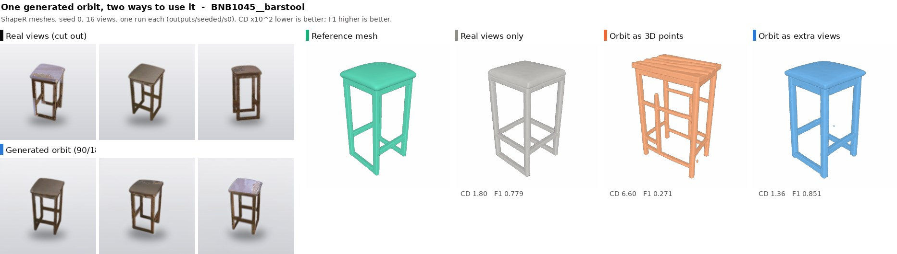
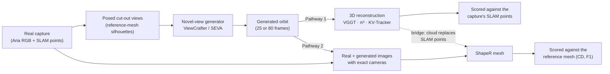
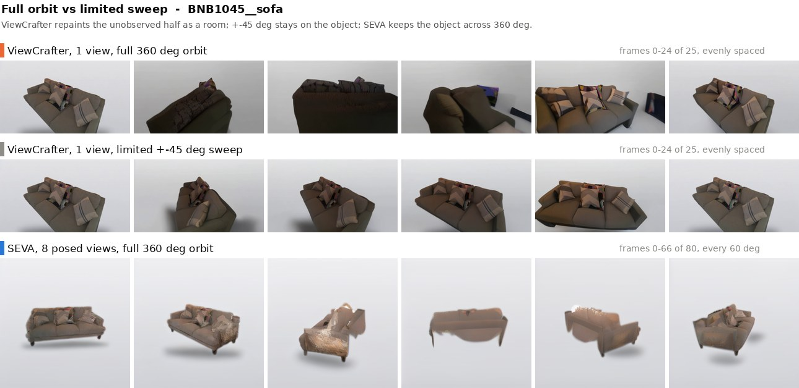
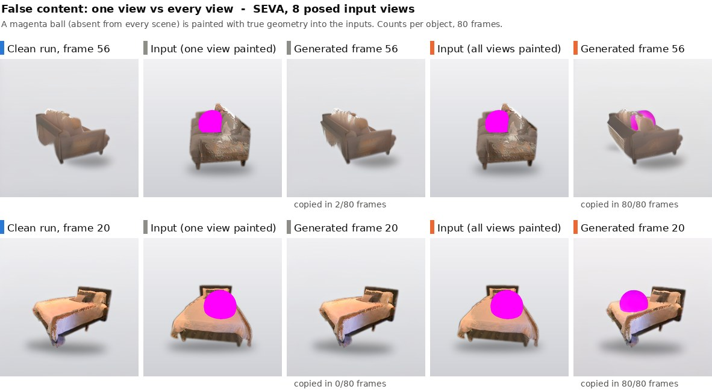
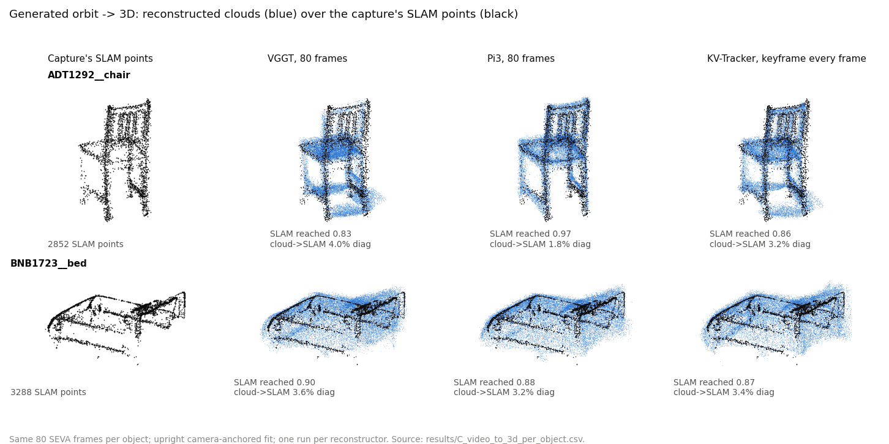
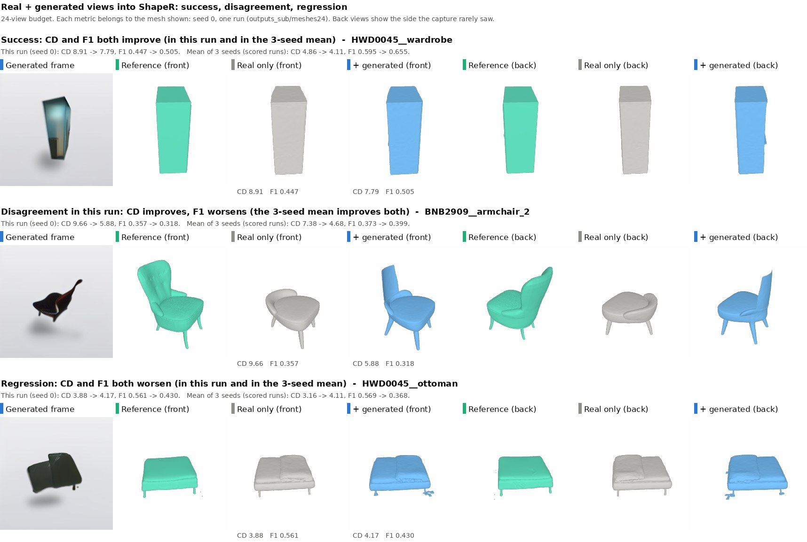
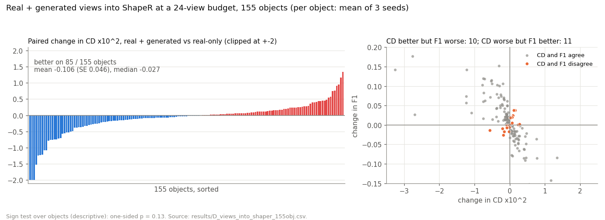
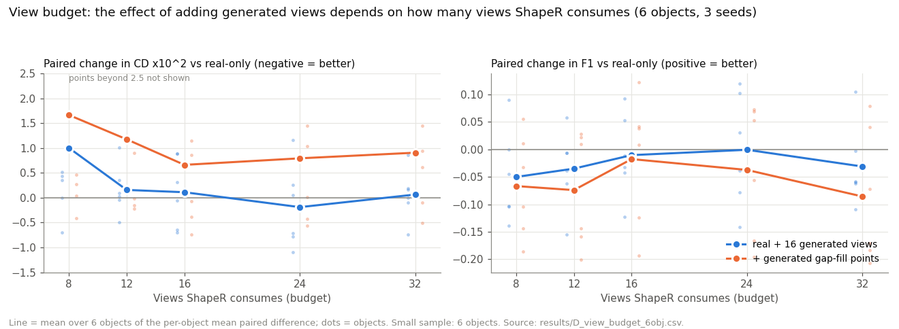

# Evaluating Generated Views for 3D Reconstruction

**When do generated viewpoints improve object reconstruction, and when do they introduce unreliable geometry?**

An experimental study of novel-view generators (ViewCrafter, Stable Virtual Camera) used to fill in the parts of an object that a casual capture never saw. Generated frames are tested two ways: as a video to reconstruct in 3D (VGGT, π³, KV-Tracker), and as extra conditioning images for an object-level mesh model (ShapeR). Real Aria captures from the ShapeR evaluation benchmark are the starting point. Results are compared with what the capture actually measured.

**Status: ongoing research.** The results below come from completed runs. Open questions and planned work are listed under [Limitations and next steps](#limitations-and-next-steps).

<p align="center"></p>

<sub>One generated orbit, two uses. When reconstructed into 3D points it **breaks** ShapeR, because this orbit drifted and its cloud sits ~20% of the object's size off the surface. Added as extra images, the same orbit **helps**. All four meshes are single seed-0 runs ([provenance](results/PROVENANCE.md#teaser)). This is one object, not an aggregate result.</sub>

---

## The two pathways

The two uses of generated frames are separate experiments with separate evidence. They are never pooled.



| | Pathway 1: generated video → 3D | Pathway 2: real + generated images → ShapeR |
|---|---|---|
| Input to the 3D stage | generated frames only | real frames and generated frames, with cameras |
| Output | point cloud (+ camera poses) | mesh |
| Reference | the capture's SLAM points (one-sided coverage) | the benchmark's reference mesh |
| Objects | 5 (chair, sofa, bed, wooden table, bench) | 6 → 16 → 40 → **155** |
| Pages | [C1](experiments/C1_video_to_3d.md), [C2](experiments/C2_points_into_shaper.md) | [D1](experiments/D1_views_into_shaper.md), [D2](experiments/D2_views_at_scale.md), [D3](experiments/D3_frame_selection.md) |

## What is mine and what is upstream

All models are used as released, except for the two local fixes listed in [docs/environments.md](docs/environments.md#local-patches-to-upstream-code). The upstream methods are credited under [References](#references-and-acknowledgements).

| Mine | Upstream (not modified, except as noted) |
|---|---|
| Object-centric scene building: cut-outs, re-aiming by homography, multi-view occlusion cleaning, exact camera chains into each generator | ViewCrafter, Stable Virtual Camera (SEVA) |
| Orbit, sweep and camera-path designs; the false-content test | — |
| Turning generated frames into VGGT / π³ / KV-Tracker inputs; camera-anchored, upright-constrained Sim(3) alignment; SLAM-point scoring | VGGT, π³, KV-Tracker (2 local fixes) |
| Turning generated frames into ShapeR inputs (pinhole → zero-distortion Fisheye624, per-view point projections), view-budget runner, seeded paired evaluation, frame-selection study | ShapeR model and its `evaluation/eval.py` metrics |
| Every experiment design, result table, figure and interpretation in this repository | ShapeR evaluation benchmark (data) |

## Experiments

| | Experiment | Question | Objects | Page |
|---|---|---|---|---|
| **A** | ViewCrafter orbits | Can one view (or 3 or 8) become a full turn around an object? | 3–5 | [A1](experiments/A1_viewcrafter_orbits.md) |
| | SEVA orbits | Does a multi-view, chosen-trajectory generator keep the object across 360°? | 5 | [A2](experiments/A2_seva_orbits.md) |
| | Observed vs unseen | How much of each orbit is generated rather than seen? | 5 | [A2](experiments/A2_seva_orbits.md#observed-vs-never-photographed-surface) |
| **B** | False content | Is false content in one input view overruled? Is repeated false content copied? | 5 | [B1](experiments/B1_false_content.md) |
| **C** | Video → 3D | VGGT vs π³ vs KV-Tracker on generated orbits; frames and keyframes; alignment | 5 | [C1](experiments/C1_video_to_3d.md) |
| | Bridge: cloud → ShapeR | Can reconstructed orbit points replace the capture's SLAM points? | 6 + 9 | [C2](experiments/C2_points_into_shaper.md) |
| **D** | Views → ShapeR | Real + generated images: composition, cameras, conditions, view budget | 6 | [D1](experiments/D1_views_into_shaper.md) |
| | At scale | Same intervention at a 24-view budget on 40 and 155 objects | 155 | [D2](experiments/D2_views_at_scale.md) |
| | Frame selection | Does choosing *which* generated frames enter (reliability, diversity, random) matter? | 16 | [D3](experiments/D3_frame_selection.md) |

Methods: [docs/methodology.md](docs/methodology.md). Metrics, units, splits and aggregation: [docs/evaluation.md](docs/evaluation.md). Every reported number: [results/](results/README.md) with its [provenance](results/PROVENANCE.md). Disagreements between records: [docs/discrepancies.md](docs/discrepancies.md).

## Selected findings

**1. A full 360° turn needs more than one view and a chosen trajectory.** Single-view ViewCrafter paints a room into the unobserved half. On 4 of 5 objects, 20–23 of 25 frames show the subject at more than 1.5× its reference area; at ±45° that never happens (0/25). SEVA, given 8 posed views and 80 target cameras, draws a full turn with **0 of 400** such frames. Its silhouette IoU reaches 0.86–0.93 of the masker's own ceiling. [A1](experiments/A1_viewcrafter_orbits.md), [A2](experiments/A2_seva_orbits.md)

**2. Most of each orbit is generated, not reconstructed.** Only 26–62% of each object's surface was ever photographed by the 8 inputs. On the sofa, bed and wooden table, 28–38 of 80 frames are more than half never-seen surface. [A2](experiments/A2_seva_orbits.md#observed-vs-never-photographed-surface)

**3. The generator overrules a lone false view but faithfully reproduces a consistent one.** A magenta ball painted into one input view is copied in 2 of 400 frames. Painted into every view, it is copied in 374 of 400. Consistency across views is what it trusts, not truth. [B1](experiments/B1_false_content.md)

**4. Reconstructed generated orbits reach more of the measured surface than real photos, but drift off it.** π³ on SEVA frames reaches 0.80–0.82 of the SLAM points. KV-Tracker with a keyframe on every frame reaches 0.83. 25 real photos reach 0.67, and VGGT on the same SEVA frames 0.70. The generated clouds still sit 3.9–6.9% of the object diagonal from the SLAM points. That is the off-surface haze of the generated far side. [C1](experiments/C1_video_to_3d.md)

| Generated video → 3D (5 objects) | SLAM points reached ↑ | cloud → SLAM, % diag ↓ |
|---|---:|---:|
| Real photos, 25 frames (VGGT) | 0.669 | 5.65 |
| ViewCrafter 1 view, 360° (VGGT) | 0.421 | 5.67 |
| SEVA 80 frames → VGGT | 0.704 | 6.14 |
| SEVA 80 frames → π³ | 0.803 | 3.90 |
| SEVA 80 frames → KV-Tracker, keyframe every frame | **0.831** | 4.54 |

**5. Generated points are a poor substitute for real SLAM points.** Swapping the capture's points for π³ or KV-Tracker orbit points makes ShapeR worse on average: ΔCD +1.80 / +2.71 ×10², ΔF1 −0.12 / −0.14 over 6 objects. On a further 9 objects, KV points are worse on 7. [C2](experiments/C2_points_into_shaper.md)

**6. Adding generated *images* gives a small average gain at a 24-view budget. It is not reliable per object, and depends on the budget.**

| Real + generated views vs real-only, 24 views | objects | ΔCD ×10² (SE) | median ΔCD | CD better | ΔF1 |
|---|---:|---:|---:|---:|---:|
| Objects pre-selected for one-sided captures | 40 | −0.207 (0.094) | −0.079 | 26 / 40 | +0.009 |
| All buildable benchmark objects | 155 | −0.106 (0.046) | −0.027 | 85 / 155 | +0.011 |

At 8 views the same intervention hurts (ΔCD +1.00, 1/6 objects better), because generated views displace real ones. [D1](experiments/D1_views_into_shaper.md#view-budget), [D2](experiments/D2_views_at_scale.md)

**7. Choosing which generated frames to add did not matter in the pilot.** Reliability-ranked, diversity-ranked, random and uniformly spaced frames are all within ±0.08 CD of each other on 16 objects. [D3](experiments/D3_frame_selection.md)

## Gallery

<p align="center"></p>
<sub>SEVA orbits from 8 posed cut-out views each (every 4th of 80 frames). Chair, sofa, bed, wooden table, bench.</sub>

| Full orbit vs limited sweep | False content: one view vs all views |
|---|---|
|  |  |
| ViewCrafter's full turn invents a room on the far side; ±45° stays on the object; SEVA keeps it ([A1](experiments/A1_viewcrafter_orbits.md)). | One painted view is overruled (2/80 frames on the sofa); painting every view makes it real (80/80) ([B1](experiments/B1_false_content.md)). |

<p align="center"></p>
<sub>Same 80 generated frames through three reconstructors, drawn over the capture's SLAM points. π³ is tightest on the chair. All three spread haze over the bed's unobserved underside ([C1](experiments/C1_video_to_3d.md)).</sub>

<p align="center"></p>
<sub>Pathway 2 at 24 views: a success, a run where CD improves while F1 worsens, and a regression. The numbers on each panel belong to that mesh (seed 0). The 3-seed mean is printed beside it, because single runs vary: the armchair's F1 drop is not in its mean ([D2](experiments/D2_views_at_scale.md#qualitative-examples)).</sub>

| Real + generated views at a 24-view budget, 155 objects | View budget, 6 objects |
|---|---|
|  |  |

## Reproducing

The experiments ran on a SLURM cluster with A100-40GB GPUs, in five separate conda environments that cannot be merged ([docs/environments.md](docs/environments.md)). [docs/reproducibility.md](docs/reproducibility.md) lists the pipeline commands per experiment, the data they need, and **which commands were actually re-run while preparing this repository**. Those are only the CPU table and figure builders:

```bash
python3 scripts/build_results.py                              # results/*.csv, results/summary.json from the raw run outputs
~/.conda/envs/shaper/bin/python scripts/make_figures.py       # assets/ (CPU, EGL)
```

`code/` is a snapshot of the experiment scripts as run, grouped by workspace. Inside it, only a workspace directory name and some comments were normalised ([code/README.md](code/README.md)). Large outputs (generated frames, clouds, meshes, ShapeR pkls; ~tens of GB) are not tracked. See [results/README.md](results/README.md#what-is-not-in-git).

## Limitations and next steps

- **Generated views are predictions, not observations.** Every "gain" is the generator's prior, and every evaluation here measures how well that prior happens to match a reference.
- **Image plausibility does not establish hidden-surface accuracy.** A complete, sharp far side ([A2](experiments/A2_seva_orbits.md)) is mostly never-photographed surface.
- **SLAM-point coverage is one-sided.** It measures how much of what the capture *measured* a cloud reaches (17–68% of each surface). It does not measure overall accuracy. A cloud can score well by covering the measured side and inventing the rest.
- **Alignment and evaluation use the same SLAM points** in Pathway 1. That limits what the coverage numbers can show. The reference mesh is reported only as a diagnostic.
- **Lower CD does not mean higher F1.** At the object level they disagree on 21 of 155 objects (10 CD-better-F1-worse, 11 the reverse), and more often within single runs.
- **Reference-assisted preprocessing.** Cut-out views come from rasterising the *reference mesh*, the orbit circle is defined in the mesh frame, and multi-view occlusion cleaning uses the mesh. None of that is available at deployment ([docs/methodology.md](docs/methodology.md#reference-assisted-steps)).
- **Cleaning and generation are confounded.** Generated frames are clean, object-only cut-outs, while real views carry clutter. No ablation yet feeds the *cleaned real views* without generation, so the share of the gain due to generation is not isolated.
- **Seeds are not objects.** Every aggregate averages seeds within an object first; standard errors and win counts are over objects. Within-object seed variation is large: one object's ΔCD is +0.01 in one run and −1.23 in its 3-seed mean.
- **Small samples in Pathway 1** (5 objects) and in the ShapeR condition studies (6 objects). The 155-object result is a small effect (sign test over objects p ≈ 0.13, descriptive) and should not be read as established.
- **Dataset filter.** 23 of 178 benchmark objects could not be built (mostly small items with no usable cut-out view), so the 155-object set leans towards furniture ([D2](experiments/D2_views_at_scale.md#objects)).

**Next steps (planned, not done):** the cleaned-real-views ablation above; a deployable version of the cut-out step that uses no reference mesh; reporting at a fixed real-view count rather than a fixed total budget; and evaluating on surface split into observed and never-observed regions. Integrating these objects into room-level maps, and any use for robotic manipulation, are future objectives. Neither is implemented or evaluated here.

## Companion project

This study has a companion, **robust-object-reconstruction**, on how input reliability and target conditioning affect object-level reconstruction. *Link to be added once its repository URL is published.*

## References and acknowledgements

This repository uses the following methods, data and code. It does not redistribute any of them. Each has its own licence, which governs its use.

- **ShapeR** and the ShapeR evaluation benchmark. Meta, arXiv:2601.11514, [github.com/facebookresearch/ShapeR](https://github.com/facebookresearch/ShapeR).
- **ViewCrafter.** Yu et al., [github.com/Drexubery/ViewCrafter](https://github.com/Drexubery/ViewCrafter) (Apache-2.0); uses DUSt3R.
- **Stable Virtual Camera (SEVA).** Stability AI, [github.com/Stability-AI/stable-virtual-camera](https://github.com/Stability-AI/stable-virtual-camera) (Stability AI Non-Commercial License).
- **VGGT.** Wang et al., arXiv:2503.11651, [github.com/facebookresearch/vggt](https://github.com/facebookresearch/vggt) (VGGT License).
- **π³ (Pi3).** [github.com/yyfz/Pi3](https://github.com/yyfz/Pi3).
- **KV-Tracker.** Imperial College London, [github.com/Marwan99/kv_tracker](https://github.com/Marwan99/kv_tracker) (KV-Tracker licence agreement).
- Data: Project Aria captures distributed with the ShapeR evaluation benchmark.

Exact upstream commits are in [docs/environments.md](docs/environments.md#upstream-versions). This repository's own code has no licence attached yet. Until one is added, all rights are reserved by the author.
