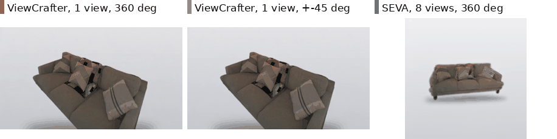

# A1 · ViewCrafter orbits: from one view to a full turn

[← experiment index](README.md) · code: [`code/viewcrafter_orbits/`](../code/viewcrafter_orbits/) · env: `viewcrafter`

## Question and hypothesis

Can a single-view novel-view generator turn one real photo of an object into a full 360° orbit that stays the *same* object? Hypothesis: it can within its documented range (ViewCrafter's config gives `d_phi` as `[-45, 45]`). Beyond that range the unobserved half has to be invented, and the object will drift or be replaced.

## Baseline and changes

| Run | Change | Objects | Source |
|---|---|---|---|
| Object in its scene | real Aria RGB view, rectified, centred on the object; 360° and ±45° trajectories | 3 | `experiment1/` |
| Object cut out | everything outside the reference-mesh silhouette replaced by a neutral gradient and contact shadow | 3, extended to 5 | `experiment2/` |
| Camera paths | six 360° paths on the cut-out images: `level`, `high` (+25°), `low` (−25°), `helix`, `wobble`, `dolly` | 3 | `experiment5/` |
| Many views | `sparse_view_interp` with 8 cut-out views (separate checkpoint) | 5 | `experiment6/` |
| 8 views on a chosen path | the 8-view cloud with the single-view trajectory | 5 | `experiment7/` |
| 3 views at measured elevation | ViewCrafter's designed view count; orbit elevation from the input cameras | 5 | `experiment8/` |
| Paths on 3 views | the six paths again, on the 3-view cloud | 5 | `experiment9/` |
| View-order fix | wooden table's 8/3-view order corrected (wrap-around bug); 10 table conditions re-run | 1 | `experiment10/` |

Objects: `ADT1292__chair`, `BNB1045__sofa`, `BNB1723__bed` (first three), then `ADT1292__woodentable` and `BNB2727__bench` (list in `shared/objects.json`).

Fixed: ViewCrafter `model.ckpt` (sparse runs: `model_sparse.ckpt`), 25 frames, seed 123, the same reference image per object across paths. The ~130 s per run is recorded in each experiment's `outputs/runs.json`.

## Commands (as run; not re-run here)

```bash
cd ~/viewcrafter_orbits
sbatch experiment2/slurm/build_views.sbatch      # cut-out reference views (shaper env, pyrender/EGL)
sbatch experiment2/slurm/run_orbits.sbatch       # ViewCrafter, orbit360 + orbit45 (viewcrafter env)
sbatch experiment5/slurm/run_paths.sbatch        # six camera paths
sbatch experiment8/slurm/run_orbits.sbatch       # three views, measured elevation
```

Trajectory files are three lines (azimuth / elevation / radius as a fraction of the pivot depth). See `experiment*/trajs/`. Example `orbit360.txt`: `0 45 … 360` / `0 0` / `0 0`.

## Metrics

- **Render coverage**: fraction of each frame covered by ViewCrafter's own point-cloud render (`render0.mp4`) before diffusion. Low coverage means the diffusion model has to invent that part of the frame.
- **Subject area ratio**: object pixel area relative to the reference frame. More than 1.5× flags an invented backdrop or a drawn-larger object. Check the frame by eye: the number alone cannot tell the two apart.
- Geometry after reconstruction is in [C1](C1_video_to_3d.md).

## Results

Cut-out objects (`experiment2/outputs/subject_fraction.json`, `render_coverage.json`):

| object | 360°: frames > 1.5× area | 360°: peak ratio | 360°: min coverage | ±45°: frames > 1.5× | ±45°: min coverage |
|---|---:|---:|---:|---:|---:|
| `ADT1292__chair` | 20 / 25 | 2.74× | 0.31 | 0 / 25 | 0.61 |
| `BNB1045__sofa` | 20 / 25 | 2.16× | 0.25 | 0 / 25 | 0.66 |
| `BNB1723__bed` | 23 / 25 | 2.31× | 0.30 | 0 / 25 | 0.64 |
| `BNB2727__bench` | 23 / 25 | 2.18× | 0.40 | 0 / 25 | 0.56 |
| `ADT1292__woodentable` | 0 / 25 | 1.48× | 0.36 | 0 / 25 | 0.57 |

Cutting the object out stopped the object being *replaced* by scene content (experiment 1). It did not stop the far side being painted in. Coverage at the far side stays at 0.25–0.40 whatever the scene treatment.

Camera paths (3 objects, `experiment5/outputs/measurements.json`): mean worst-frame coverage is `low` 0.362, `wobble` 0.290, `level` 0.286, `helix` 0.263, `high` 0.260, `dolly` 0.226. The gap to not going all the way round (±45°: 0.56–0.66) is larger than the whole spread across paths, and no path wins on every object.




What these orbits reconstruct to in 3D, including the 3- and 8-view conditions, is in [C1](C1_video_to_3d.md#results). Scored against the SLAM points, the ±45° sweep (0.660) reaches more of the measured surface than any 360° ViewCrafter orbit (0.381–0.652).

## Interpretation

ViewCrafter has no object-level representation and no channel for "this object" except the crop itself. A full turn asks it to extrapolate past its trained range, and it does so by inventing a backdrop. More input views (3, 8) help coverage. They don't make the far side observed, and in sparse mode the trajectory is no longer ours: `sparse_view_interp` interpolates the inputs' own poses.

## Limitations

- 3–5 objects. Per-path and per-view-count differences are within what one object can swing (see the scale confound in [C1](C1_video_to_3d.md#alignment)).
- The area ratio is a proxy: on the chair, more than 1.5× partly means "drawn larger", not "room invented".
- The cut-out uses the reference mesh ([methodology](../docs/methodology.md#reference-assisted-steps)).
- The wooden table's 360° orbit does not cross the 1.5× threshold. Its failure shows up in coverage and in [C1](C1_video_to_3d.md), not in this metric.

## Next experiment motivated

A generator that takes several posed views **and** target cameras we choose → [A2, SEVA](A2_seva_orbits.md).
