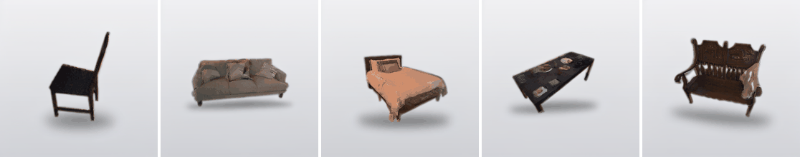
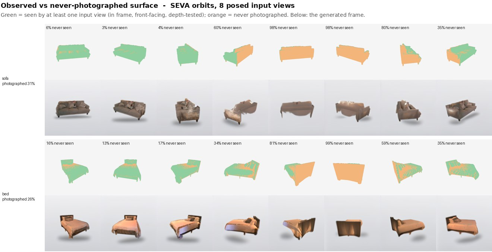

# A2 · SEVA orbits, and how much of them was ever observed

[← experiment index](README.md) · code: [`code/seva_orbits/exp1`](../code/seva_orbits/exp1), [`exp2`](../code/seva_orbits/exp2) · env: `svcam` (generation), `shaper` (scene building)

## Question and hypothesis

Stable Virtual Camera (SEVA, `img2trajvid`) takes P posed input views *and* a list of target cameras. Given 8 real cut-out views and 80 target cameras on a full circle, does it keep the object's identity all the way round? And how much of what it draws was actually photographed?

## Setup

- **Objects (5):** `ADT1292__chair`, `BNB1045__sofa`, `BNB1723__bed`, `ADT1292__woodentable`, `BNB2727__bench`.
- **Inputs:** 8 real Aria RGB views per object, cut out with the reference-mesh silhouette. Each view is re-aimed at the object by an exact homography (rotate, don't crop), because SEVA asserts the principal point lies in frame. Every view is verified by re-rasterising the mesh through the final camera; the builder refuses below IoU 0.80. Multi-view occlusion cleaning repairs or drops views that disagree with the others (`scripts/occlusion.py`).
- **Targets:** 80 cameras on a circle in the object's mesh frame (exact centre and radius), at the elevation of the inputs.
- **Generation:** SEVA v1.1, `--task img2trajvid`, the cfg and settings recorded in `exp1/slurm/run_seva.sbatch`. One seed. About 50 min for all 5 objects.

```bash
cd ~/stable_virtual_camera
sbatch exp1/slurm/build_scenes.sbatch   # shaper env
sbatch exp1/slurm/run_seva.sbatch       # svcam env; exports SEVA_VAE_PATH (see docs/environments.md)
sbatch exp1/slurm/score.sbatch          # silhouette IoU per frame
python exp2/scripts/observability.py    # observed vs never-photographed surface
```

## Metrics

- **Orbit IoU:** silhouette of each generated frame against the reference mesh rasterised from exactly the camera that frame was asked for.
- **Masker ceiling:** the same masker's IoU on the *input* views, whose true masks are known. Its IoU on generated frames cannot exceed this, so the **share of ceiling** is the reported quantity.
- **Observability:** a mesh vertex counts as observed if at least one of the 8 inputs saw it (in frame, front-facing, depth-tested). Per orbit frame, the share of visible surface that was never observed.

## Results

`exp1/outputs/scores.json`, `exp1/outputs/input_arc_corrected.json`:

| object | input arc (corrected) | orbit IoU | masker ceiling | share of ceiling | frames > 1.5× area |
|---|---:|---:|---:|---:|---:|
| `BNB1045__sofa` | 93.4° | 0.851 | 0.956 | 0.89 | 0 / 80 |
| `BNB1723__bed` | 81.1° | 0.848 | 0.935 | 0.91 | 0 / 80 |
| `ADT1292__woodentable` | 108.7° | 0.801 | 0.859 | 0.93 | 0 / 80 |
| `BNB2727__bench` | 102.4° | 0.788 | 0.916 | 0.86 | 0 / 80 |
| `ADT1292__chair` | 132.8° | 0.751 | 0.824 | 0.91 | 0 / 80 |

The invented-backdrop failure from [A1](A1_viewcrafter_orbits.md) does not occur (0 of 400 frames). Input arc does not predict quality: the sofa does best from one of the narrowest arcs.



### Observed vs never-photographed surface

`exp2/outputs/observability.json`:

| object | surface ever photographed | orbit frames > 50% never-seen | mean never-seen share per frame |
|---|---:|---:|---:|
| `ADT1292__chair` | 61% | 0 / 80 | 9% |
| `BNB2727__bench` | 56% | 24 / 80 | 24% |
| `ADT1292__woodentable` | 39% | 32 / 80 | 45% |
| `BNB1045__sofa` | 31% | 38 / 80 | 48% |
| `BNB1723__bed` | 26% | 28 / 80 | 44% |



## Interpretation

SEVA produces a coherent, complete-looking object in every frame. In the frames dominated by orange surface, though, that object is the generator's prior, not a reconstruction. The IoU dips line up with the never-seen frames. A plausible image of the back of a sofa is not evidence about the back of *this* sofa.

## Limitations

- 5 objects, one seed each.
- IoU checks the outline only, not the surface or texture.
- Observability depends on the reference mesh and exact poses, so it is an analysis tool, not something a deployed system could compute.
- An earlier record mis-stated the input arc for arcs crossing 0° (chair, bench). The table uses the corrected values ([discrepancies](../docs/discrepancies.md)).

## Next experiment motivated

If the generator mostly invents, how does it treat evidence that is wrong? → [B1](B1_false_content.md). And does the generated geometry hold up in 3D? → [C1](C1_video_to_3d.md).
