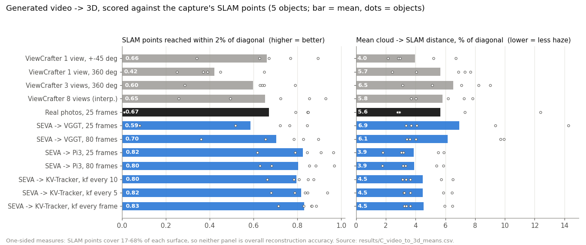

# C1 · Pathway 1: generated video → 3D (VGGT, π³, KV-Tracker)

[← experiment index](README.md) · code: [`code/viewcrafter_orbits/experiment3,4,9`](../code/viewcrafter_orbits/), [`code/seva_orbits/exp3,4,5`](../code/seva_orbits/) · envs: `shaper` (VGGT, scoring), `kvtracker` (π³, KV-Tracker)

## Question and hypothesis

If the generated orbits from [A1](A1_viewcrafter_orbits.md) and [A2](A2_seva_orbits.md) are fed to a feed-forward reconstructor, how much real geometry comes back? Hypothesis: a coherent generated orbit adds *coverage*, because the frames are consistent enough to triangulate. It will not add *precision*, because the generated far side has no measurement behind it.

## Inputs and conditions

Objects: the same 5 as A2. Only generated frames enter (no real frames), except for the `real` control.

| condition | frames into the reconstructor | reconstructor |
|---|---|---|
| `real` | 25 real Aria RGB frames, cut out the same way | VGGT |
| `gen360`, `gen45` | ViewCrafter 1 view, 360° / ±45°, 25 frames | VGGT |
| `v3_360`, `v3_360g`, `sparse`, `mv360`, `p3_*` | ViewCrafter 3 views (measured / guessed elevation), 8-view interpolation, 8 views on a chosen path, six paths on 3 views | VGGT |
| `seva360`, `seva360f` | SEVA orbit, 25 / all 80 frames | VGGT (`facebook/VGGT-1B`, depth branch) |
| `seva360p`, `seva360fp` | SEVA orbit, 25 / 80 frames | π³ batch |
| `seva360fk10`, `fk5`, `fk1` | SEVA orbit, 80 frames streamed | KV-Tracker, keyframe every 10 / 5 / 1 frame (9 / 17 / 80 keyframes) |

Background pixels are removed by the shared subject mask. Points below the 0.35 confidence quantile are dropped (π³ logits passed through a sigmoid first).

## Alignment

Reconstructions come out in an arbitrary similarity frame, so each cloud is fitted to the capture's **SLAM points** (`points_model`, which live in the reference mesh's frame) by Sim(3).

- **Upright, camera-anchored fit** (`experiment3/scripts/align_and_score.py::fit_upright`, used through `fit_any`). The reconstructor's own camera ring defines "up", which is rotated onto +z. The search is then over azimuth × scale, followed by ICP, and fits tilted more than 60° are rejected. Every current number uses this fitter. All 95 sets have `up_z` ≥ +0.52.
- **Why it matters.** Two earlier fitters exist. The original two-axis ICP seeding left **60/60** ViewCrafter/real clouds upside down. A free SO(3) grid still left 21/60 flipped, because on a partial cloud the mirrored pose often has the lower Chamfer. Numbers from those layers appear in older records and are **superseded** ([discrepancies](../docs/discrepancies.md)).
- **Scale confound.** For partial clouds the similarity fit is under-constrained. Per-object changes tracked the fitted scale (r = +0.98 in the 8-view study before the upright fit), so differences between partial-coverage conditions are alignment-limited.

## Metrics

All distances are percent of the reference-mesh diagonal.

- **SLAM points reached:** share of SLAM points with a cloud point within 2% (higher = more of the *measured* surface covered).
- **cloud → SLAM:** mean distance from cloud points to the nearest SLAM point (lower = less off-surface haze).
- **cloud → mesh:** distance to the reference mesh, reported as a **diagnostic only**.
- **Pose ATE:** KV-Tracker / π³ cameras against the 80 cameras SEVA was asked for (Sim(3), evo).

Scoring is seeded (`zlib.crc32` of the cloud bytes), so identical clouds score identically. `p3_level` and `v3_360` are the same clouds and score exactly the same, which is a standing end-to-end check.

## Results

Condition means over 5 objects (`results/C_video_to_3d_means.csv`, rebuilt from `experiment4/outputs/realigned_to_slam.json`, `experiment10/outputs/realigned_to_slam.json` and `exp5/outputs/slam_scores.json`; equal to `experiment10/outputs/final_means_upright_with_table_fix.json` to 3 d.p.):

Per object, SLAM points reached / cloud → SLAM % diag:

| object | real | gen45 | gen360 | v3_360 | sparse | SEVA→VGGT 80 | SEVA→π³ 80 | SEVA→π³ 25 | SEVA→KV kf1 |
|---|---|---|---|---|---|---|---|---|---|
| `ADT1292__chair` | 0.79 / 2.9 | 0.63 / 2.8 | 0.25 / 7.3 | 0.29 / 7.1 | 0.26 / 7.8 | 0.83 / 4.0 | 0.97 / 1.8 | 0.96 / 1.8 | 0.86 / 3.2 |
| `ADT1292__woodentable` | **0.01** / 12.4 | 0.34 / 6.7 | 0.45 / 6.9 | 0.64 / 8.2 | 0.72 / 6.2 | 0.36 / 9.9 | 0.63 / 5.9 | 0.62 / 5.9 | 0.89 / 5.9 |
| `BNB1045__sofa` | 0.85 / 2.8 | 0.89 / 2.1 | 0.37 / 2.4 | 0.79 / 3.1 | 0.85 / 3.7 | 0.66 / 3.4 | 0.68 / 3.3 | 0.79 / 3.2 | 0.71 / 3.6 |
| `BNB1723__bed` | 0.85 / 2.9 | 0.77 / 2.9 | 0.39 / 4.1 | 0.63 / 5.1 | 0.93 / 4.0 | 0.90 / 3.6 | 0.88 / 3.2 | 0.91 / 3.0 | 0.87 / 3.4 |
| `BNB2727__bench` | 0.85 / 7.3 | 0.67 / 5.2 | 0.65 / 7.7 | 0.65 / 9.0 | 0.49 / 7.2 | 0.78 / 9.7 | 0.85 / 5.4 | 0.84 / 5.5 | 0.83 / 6.5 |

The wooden table's `real` control is a genuine failure: only 10 of 1 198 real frames frame the whole table, and VGGT's cloud misses it. It is **included** in the `real` mean (0.669). Excluding it gives 0.834.

**Frames and keyframes.** 80 SEVA frames beat 25 under VGGT (0.704 vs 0.586), but not under π³ (0.803 vs 0.824). For KV-Tracker, more keyframes reach more (kf10 0.795 → kf5 0.817 → kf1 0.831) at the same haze (4.5%). Upstream caps the cache at 20 keyframes in camera-only mode, so `kf1` needs a local patch ([environments](../docs/environments.md#local-patches-to-upstream-code)).

**Poses** (`exp5/outputs/poses.json`, mean of 5): ATE against the requested cameras is π³ batch 8.0 cm (4.6% of orbit radius), KV kf1 10.3 cm (5.8%), kf5 10.8 cm, kf10 11.7 cm. ATE mixes reconstructor error with any drift of the generated frames away from the requested cameras.

## Interpretation

- Generated orbits through π³ or KV-Tracker reach more of the measured surface than 25 real photos through VGGT (0.80–0.83 vs 0.67). But the comparison changes both the frames and the reconstructor, and real photos cover only the wearer's arc (4–5 of 12 azimuth bins).
- No generated cloud matches real SLAM precision. The SLAM points themselves sit 0.35–0.73% of the diagonal from the reference surface (`experiment4/outputs/baselines.json`), while every generated cloud is 3.9–9.9% from the SLAM points. **Generated orbits add coverage, not precision.** The far side becomes haze.
- π³ is tighter than VGGT on the same frames (3.9 vs 6.1% haze at 80 frames). KV-Tracker ≈ π³ in coverage, with somewhat more haze.

## Limitations

- **One-sided metric.** SLAM points cover 17–68% of each reference surface (`baselines.json`, `mesh_to_slam` within 2%). Reaching them says nothing about the unmeasured side, which is exactly where generation acts.
- **Fit and score share the SLAM points.** Alignment is optimised against the same points it is scored on, which favours clouds that hug them.
- 5 objects, one generation and one reconstruction per condition.
- The bench sits at 40–55° tilt in most upright fits (`up_z` 0.56–0.79), inside the guard but worth a visual check.
- cloud → mesh uses the reference mesh and is a diagnostic, not a deployable score.

## Next experiment motivated

If the clouds cover the measured side well, can they replace the sparse SLAM points as ShapeR's point input? → [C2](C2_points_into_shaper.md).
