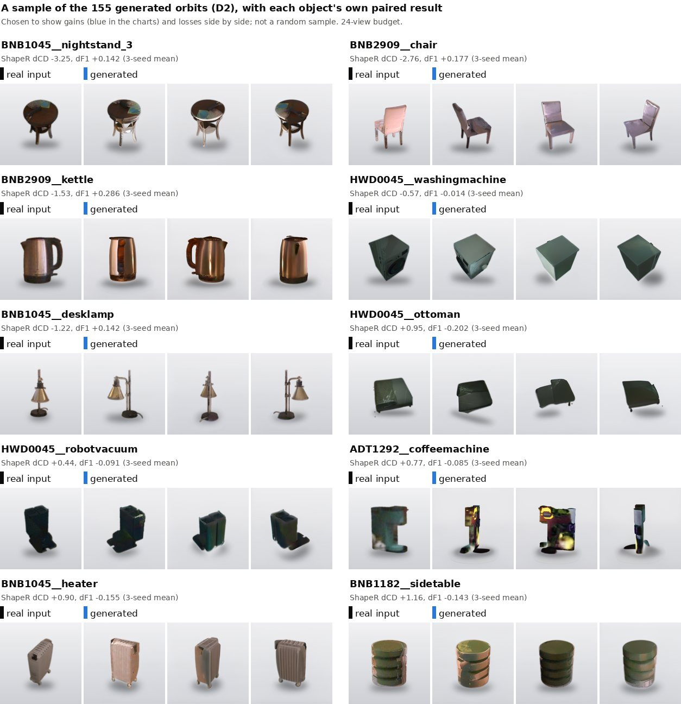

# D2 · Real + generated views at scale (40 and 155 objects)

[← experiment index](README.md) · code: [`code/generated_to_shaper/scripts/subset_runner.py`](../code/generated_to_shaper/scripts/subset_runner.py), [`pick_subset.py`](../code/generated_to_shaper/scripts/pick_subset.py) · envs: `shaper`, `svcam`

## Question and hypothesis

Does the [D1](D1_views_into_shaper.md) `views` condition (real views plus 16 generated SEVA views, SLAM points unchanged) hold up beyond 6 objects? Hypothesis: it helps most where the capture is one-sided, and it helps little on average.

## Objects

- **Benchmark:** all 178 objects of the ShapeR evaluation benchmark were attempted (`objects_full.json`). **155 were built** (`objects_full_built.json`). The 23 excluded objects and the reason for each are in the scene-building logs (`logs/s2s-bfull-284635.out`, `-284636.out`):
  - **17 had fewer than 2 usable cut-out views.** These are mostly small items: dish soap, donut, jar, mug, picture frame, scissors (`ADT1292`), speaker, vase ×2, lemon, soap dispenser, cup, topiary, plant pot, game controller, medicine bottle and remote control.
  - **5 were refused** because the worst reprojection IoU fell below 0.80: `ADT1292__chair_2`, `ADT1292__shelvingunit`, `HWD0045__scissors`, `HWD0045__woodenchair`, `HWD0045__woodenchair_3`.
  - **1 lost every view in the consistency check:** `ADT1292__trashbin`.

  The 155-object set therefore leans towards furniture and larger items.
- **40-object subset** (`pick_subset.py`): chosen **from capture properties only**, before any ShapeR output was inspected. The criteria are one-sidedness (share of 24 azimuth bins with a camera), object size and mean visible fraction, with a size floor. The 40 are a subset of the 155.

## Setup

24-view budget (chosen in [D1](D1_views_into_shaper.md#view-budget)), `balance` preset, seeds 0/1/2 with the RNG reset per object, so `slam` and `views` share identical noise. Per object, the pkl is built, both conditions are scored, and the pkl is deleted (the /home quota does not hold 155 × ~120 MB).

```bash
cd ~/seva_to_shaper
sbatch slurm/20_build_full.sbatch                                  # scenes for all 178 (155 built)
sbatch slurm/21_seva_subset.sbatch                                 # SEVA orbits (svcam env)
SHARD=0 N_SHARDS=2 sbatch --export=ALL,SHARD=0,N_SHARDS=2 slurm/23_subset_shaper.sbatch
```

## Results

Paired over objects, seeds averaged within each object (`results/D_views_into_shaper_155obj.csv`, `results/summary.json`, from `outputs_sub/seeded/s{0,1,2}/per_object/*.json`, 930 runs):

| set | objects | real-only CD / F1 | + generated CD / F1 | ΔCD (SE over objects) | median ΔCD | CD better | ΔF1 | F1 better | sign test p (one-sided) |
|---|---:|---|---|---:|---:|---:|---:|---:|---:|
| 40 one-sided captures | 40 | 3.221 / 0.657 | 3.014 / 0.665 | −0.207 (0.094) | −0.079 | 26 | +0.009 | 24 | 0.04 |
| all built | 155 | 2.331 / 0.748 | 2.225 / 0.759 | −0.106 (0.046) | −0.027 | 85 | +0.011 | 86 | 0.13 |


- **CD and F1 disagree on 21 of 155 objects:** 10 objects get a better CD and a worse F1, and 11 the reverse.
- Seed 0 alone gives ΔCD −0.118, with 94 of 155 objects better. That is a single seed, shown only to illustrate seed sensitivity.
- The workspace summary (`outputs_sub/full155_summary.json`) reports SE **0.031**. That figure treats the 465 seed-level pairs as independent. With objects as the unit it is **0.046** ([discrepancies](../docs/discrepancies.md)).
- Largest gains: `BNB1045__nightstand_3` −3.25, `BNB2909__chair` −2.76, `BNB2909__armchair_2` −2.70. The full list is in the CSV, sorted by object.

### Qualitative examples



Hand-picked to show gains and losses; the coffee-machine orbit is a visible generation failure.


The meshes come from a separate **seed-0 re-run** saved with meshes (`outputs_sub/meshes24/per_object/`). Its metrics differ from the scored seed-0 run by up to 0.06 CD, because the kernels are not bit-deterministic. Each panel prints its own run's numbers next to the 3-seed mean. Single runs can disagree with the mean: in the armchair's seed-0 run F1 drops (0.357 → 0.318), while over 3 seeds it rises (0.373 → 0.399). Within-object seed variation can exceed the effect itself. `ADT1292__nightstand` has ΔCD +0.01 in its seed-0 mesh run and −1.23 in its 3-seed mean.

## Interpretation

- A **small average improvement**, larger on one-sided captures (−0.21 vs −0.11). Fewer than 60% of objects improve, and the median change is close to zero.
- This is evidence that generated views *can* add useful information. It is not evidence that they reliably do. The sign tests are descriptive. No significance claim is made, and no correction for the budget having been chosen on 6 of these objects is applied.

## Limitations

- **Cleaning plus generation.** Every generated view is a clean, object-only cut-out, and the real views are not. This experiment cannot separate "a generated view" from "a clean view". The control (cleaned real views, no generation) is **not yet run**.
- **Reference-assisted inputs.** Cut-outs, orbit geometry and occlusion cleaning all use the reference mesh.
- Seeds are repeats, not samples. All counts and SEs are over objects.
- The 155-object set excludes 23 mostly small objects.
- The real/generated split of the views ShapeR used is not recorded per object.

## Next experiment motivated

If the gain is real but uneven, does it matter *which* generated frames go in? → [D3](D3_frame_selection.md).
