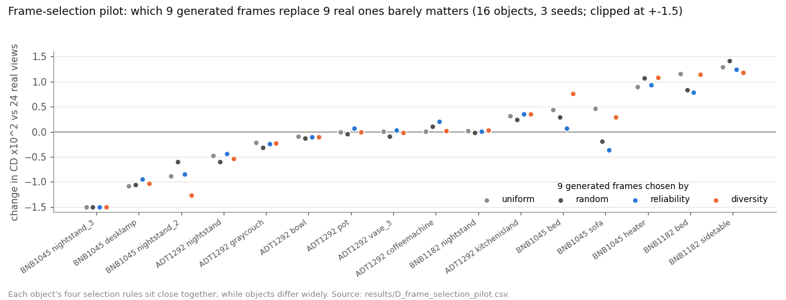

# D3 · Which generated frames? A controlled selection pilot

[← experiment index](README.md) · code: [`code/generated_to_shaper/scripts/sel_*.py`](../code/generated_to_shaper/scripts/) · env: `shaper`

## Question and hypothesis

In D1/D2, ShapeR's own view selector decided how many generated frames it used: anywhere from 1 to 9 of 24 in the two recorded cases. Here the view set is **frozen**: exactly 15 real + 9 generated frames. The only thing that varies is *which* 9 generated frames are used. Hypothesis: frames scored as reliable from inference-time evidence beat uniformly spaced ones.

## Setup

- **Objects:** 16 development objects (`sel/dev_objects.json`), all from the 155.
- **Exact view sets** (`sel_build.py`): supplying exactly `num_views` images makes ShapeR's k-means selector keep all of them. The real frames are chosen once per object by ShapeR's own ranking and shared by every condition.
- **Conditions:** **A** real only (24 real frames; *not* budget-matched, reported for reference) · **B** uniform (9 generated, evenly spaced) · **C** random (seed logged) · **D** reliability (`sel_score.py`) · **E** diversity only (control for D).
- **Reliability score** (inference-time only, no reference mesh): `agree` is the share of the capture's SLAM points projecting into the frame that land on the rendered object, and `intact` is the largest-component share of the subject mask, penalised for area drift. They are combined greedily with a viewpoint-spread term.
- **Camera check** (`sel_check_corr.py`, run on 6 objects, only 2 of them in this pilot): do the generated pixels sit where the requested camera says? The mean share of projected SLAM points landing on the generated object is 0.52–0.90, with minimum frames down to 0.46 (`sel/camera_correspondence.json`). So the reprojection signal is meaningful for some objects and weak for others.
- 3 seeds, RNG reset per object. Aggregation is at the object level (`sel_eval.py`).

```bash
cd ~/seva_to_shaper
sbatch slurm/41_sel_pilot.sbatch          # -> sel/pilot/s{0,1,2}/per_object/<obj>__{A..E}.json
```

## Results

All 16 objects, mean of 3 seeds (`results/D_frame_selection_pilot.csv`, `results/summary.json`):

| comparison | ΔCD ×10² (SE over objects) | CD better | ΔF1 |
|---|---:|---:|---:|
| D reliability vs B uniform | −0.077 (0.063) | 8 / 16 | −0.003 |
| D reliability vs C random | −0.007 (0.035) | 6 / 16 | −0.007 |
| D reliability vs E diversity | −0.076 (0.074) | 9 / 16 | −0.001 |
| C random vs B uniform | −0.070 (0.053) | 11 / 16 | +0.005 |
| B uniform (15 real + 9 gen) vs A (24 real) | −0.087 (0.266) | 7 / 16 | −0.008 |

Condition means, CD / F1: A 3.463 / 0.669 · B 3.376 / 0.661 · C 3.307 / 0.666 · D 3.299 / 0.659 · E 3.375 / 0.659.



## Interpretation

No selection rule separates from the others. Reliability scoring is no better than random. Swapping 9 real frames for 9 generated ones (B vs A) is neutral on average but varies widely per object: `BNB1045__nightstand_3` 5.45 → 2.20, `BNB1045__heater` 2.01 → 2.91.

## Discrepancy

`sel/pilot/summary.json` covers only the **first 8** objects (one shard), although all 16 finished. On those 8, B vs A is −0.446. Over all 16 it is −0.087. The table above uses all 16 ([discrepancies](../docs/discrepancies.md)).

## Limitations

- A pilot: 16 objects, chosen as development objects.
- The reliability score depends on SLAM-point reprojection, which is weak where the generated frames do not follow the requested camera.
- A is not budget-matched (24 real vs 15 real + 9 generated).

## Next experiment motivated

Not yet run: a test split, and selection signals that do not rely on reprojection accuracy.
